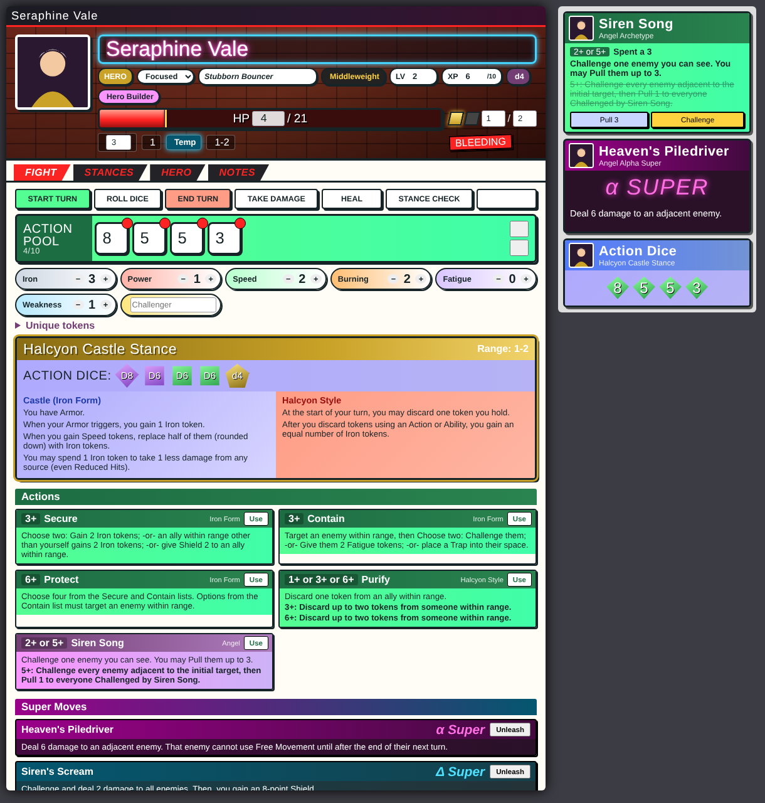
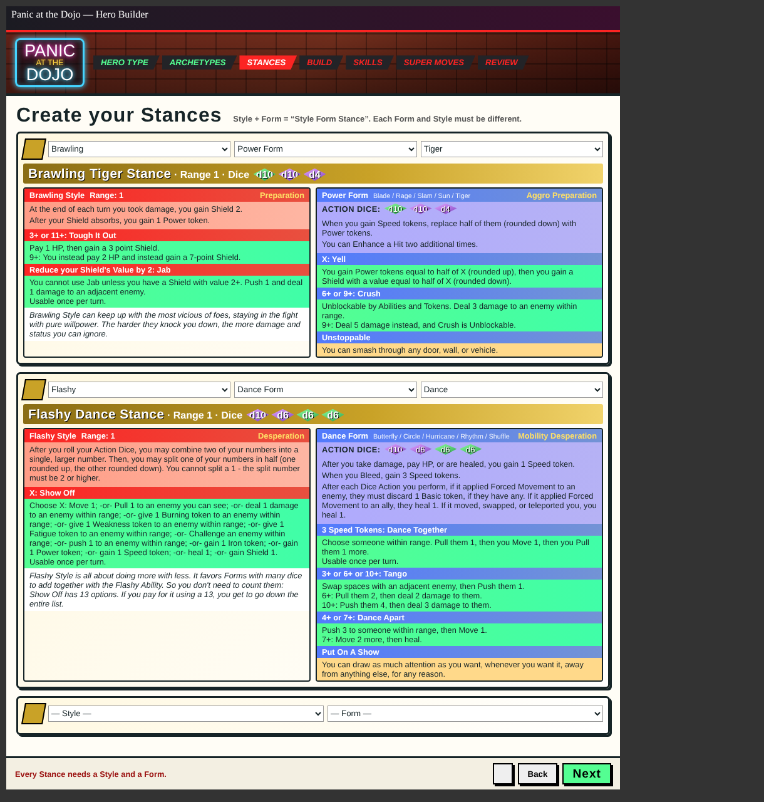

# Panic at the Dojo — Foundry VTT

Unofficial Foundry VTT (v13–v14) support for **Panic at the Dojo: Patch'd Up** by Vel Mini. Works on The Forge.

| Package | Type | Manifest URL |
|---|---|---|
| Panic at the Dojo: Patch'd Up | System | `https://raw.githubusercontent.com/Jayty07/Panic-at-the-Dojo-Foundry/main/panic-at-the-dojo/system.json` |
| Panic at the Dojo: Hero Builder | Module | `https://raw.githubusercontent.com/Jayty07/Panic-at-the-Dojo-Foundry/main/patd-hero-builder/module.json` |

## Install
**The Forge:** Bazaar → *Custom Systems* → paste the system manifest URL; then *Custom Modules* → paste the module manifest URL.
Or upload `dist/panic-at-the-dojo.zip` and `dist/patd-hero-builder.zip` with the Import Wizard.

**Self-hosted Foundry:** Setup → *Game Systems* → *Install System* → paste the manifest URL (same for the module under *Add-on Modules*).

Recommended modules: **Bar Brawl**, **Isometric Perspective**, **Sequencer**, and optionally **JB2A** (free).

See [`panic-at-the-dojo/README.md`](panic-at-the-dojo/README.md) and [`patd-hero-builder/README.md`](patd-hero-builder/README.md) for features.

## Releasing an update
1. Bump `version` in `panic-at-the-dojo/system.json` and/or `patd-hero-builder/module.json`.
2. Run `./build.sh` to rebuild the zips in `dist/`.
3. Commit and push. Foundry and The Forge pick up the new version from the manifest.

## License
Rules content © Vel Mini / Liberi Gothica Games, CC BY-SA 4.0. Code MIT. No book artwork is included. Fan project, not affiliated with the publisher. See `panic-at-the-dojo/LICENSE.txt`.
